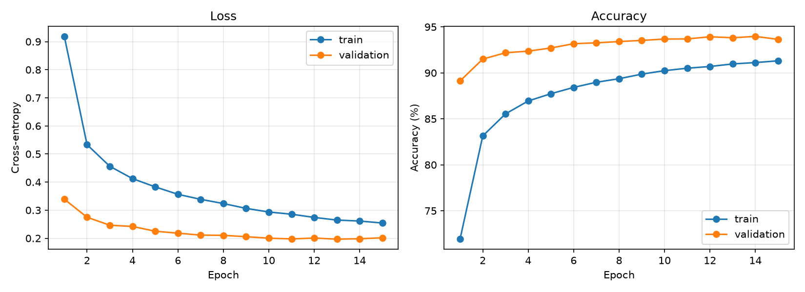
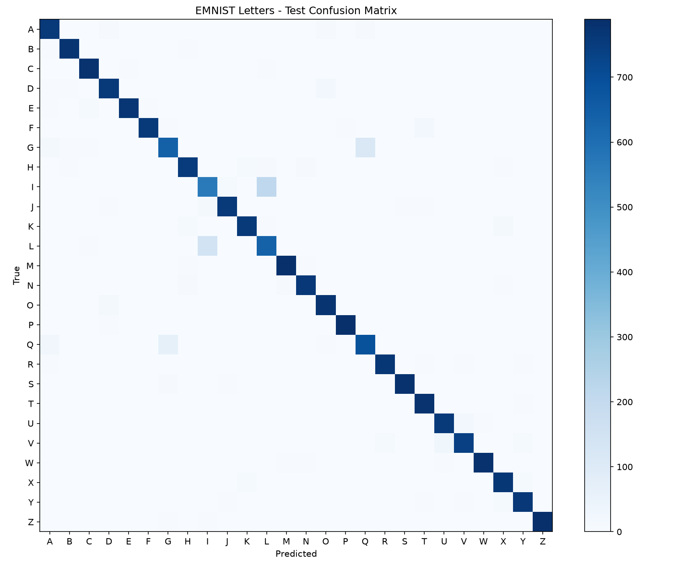
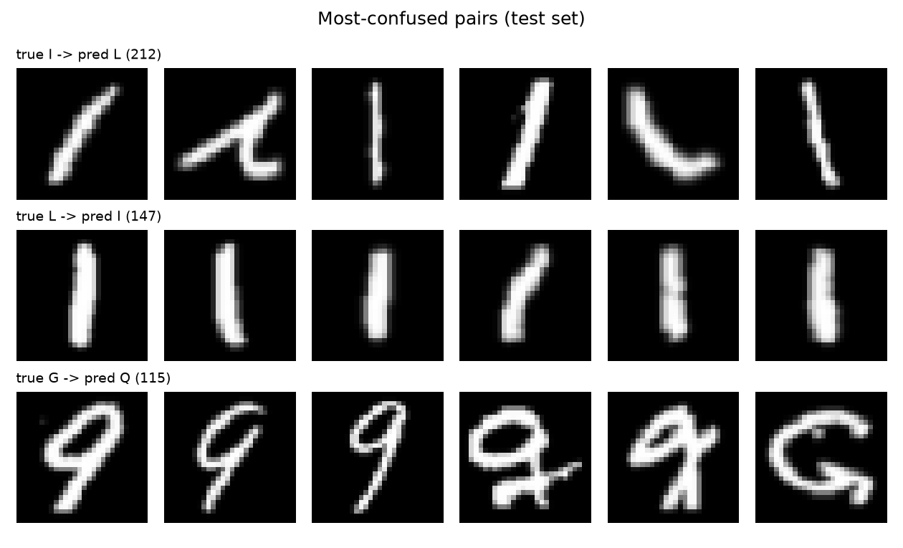

# EMNIST Letter Classifier

A compact PyTorch CNN that recognizes handwritten letters A-Z from the EMNIST **letters** split, reaching **93.35% test accuracy** after about two minutes of training on a single consumer GPU.



## Results

| Metric | Value |
|---|---|
| Test accuracy | **93.35%** (20,800 images) |
| Best validation accuracy | 93.97% (epoch 14 of 15) |
| Trainable parameters | 1,201,946 |
| Training time | 107 s for 15 epochs |
| Hardware | NVIDIA GeForce RTX 3060 (12 GB) |
| Settings | Adam, lr 1e-3, batch size 128, seed 42 |

The checkpoint is chosen by validation accuracy, and the test set is used once, in `evaluate.py`. Full per-epoch numbers are in [`results/training.json`](results/training.json) and per-class accuracy in [`results/metrics.json`](results/metrics.json).

Validation accuracy sits above training accuracy throughout. That is expected here: dropout is active during training passes and switched off during evaluation.

### Where the model fails



The letters split merges upper and lower case into one class, so some classes contain shapes that look almost identical to another class. The three most-confused pairs on the test set:

| True | Predicted | Count | Why |
|---|---|---|---|
| I | L | 212 | Uppercase `I` and lowercase `l` are both a single vertical stroke |
| L | I | 147 | Same ambiguity in the other direction |
| G | Q | 115 | Lowercase `g` and lowercase `q` differ only in the tail |



Per-class accuracy is lowest for I (70.3%), L (79.5%), G (79.9%) and Q (85.9%), and highest for P (98.6%), Z (98.3%) and M (98.0%). Many of the I/L errors are not recoverable from the image alone, which puts a ceiling on any model trained on this split.

## Dataset

[EMNIST](https://www.nist.gov/itl/products-and-services/emnist-dataset) extends MNIST to handwritten letters. The letters split has 26 balanced classes of 28x28 grayscale images: 124,800 for training and 20,800 for testing. This project holds out 10% of the training set (12,480 images, fixed seed) for validation.

Two quirks of the raw data are handled in [`src/data.py`](src/data.py):

- Images are stored transposed, so each one is transposed back to read upright.
- Labels run 1-26, so they are shifted to 0-25.

## Model

```
Input        1 x 28 x 28
Conv 3x3,32  -> ReLU -> Conv 3x3,64 -> ReLU -> MaxPool 2x2 -> Dropout 0.25
Flatten      -> Linear 128 -> ReLU -> Dropout 0.5 -> Linear 26
```

Two unpadded 3x3 convolutions take 28 to 24 and pooling halves that to 12, so the flattened size is 64 x 12 x 12 = 9,216. Most of the parameters (1.18M) sit in the first linear layer.

## Quickstart

```bash
pip install -r requirements.txt
python -m src.train --epochs 15
python -m src.evaluate
```

Training downloads EMNIST (about 560 MB) to `data/` on first run, saves the best checkpoint to `checkpoints/best.pt`, and writes training curves to `results/`. Evaluation writes the confusion matrix, error gallery and `metrics.json`.

If the automatic download fails with an SSL certificate error (NIST's server certificate has lapsed at times), download `gzip.zip` from the [EMNIST page](https://www.nist.gov/itl/products-and-services/emnist-dataset) and place it at `data/EMNIST/raw/gzip.zip`. torchvision checks its MD5 and extracts it on the next run.

To skip training, download `best.pt` from the [Releases page](https://github.com/gabewat2003/emnist-letter-classifier/releases) into `checkpoints/`.

[`notebooks/01_demo.ipynb`](notebooks/01_demo.ipynb) shows sample images with their labels and the model's predictions on random test images.

## Project layout

```
emnist-letter-classifier/
├── src/
│   ├── data.py         # datasets, transforms, train/val/test loaders
│   ├── model.py        # CNN definition
│   ├── train.py        # training loop, validation-based checkpointing, curves
│   └── evaluate.py     # test accuracy, confusion matrix, error gallery
├── notebooks/01_demo.ipynb
├── results/            # figures and metrics from the run above
└── requirements.txt
```

## Possible extensions

- Data augmentation (small rotations and shifts) to measure its effect on the I/L and G/Q confusions
- Batch normalization or a deeper network to compare accuracy against parameter count
- The EMNIST `byclass` split, which covers digits and case-sensitive letters

## Tech

Python, PyTorch, torchvision, NumPy, scikit-learn, matplotlib.
